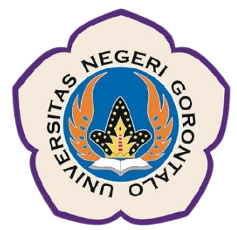
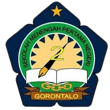

<div align="center">

&nbsp;&nbsp;&nbsp;

# 🧠 Media Pembelajaran Berpikir Komputasional

**Media belajar interaktif untuk siswa kelas 9: dekomposisi, pola, abstraksi, dan algoritma.**


</div>

---

## 📖 Tentang Proyek

**Media Pembelajaran Berpikir Komputasional** adalah aplikasi web untuk membantu siswa kelas 9 memahami konsep dasar berpikir komputasional lewat materi, video, latihan interaktif, dan kuis berwaktu. Guru dapat memantau hasil kuis, mengelola data siswa, dan membuat bank soal sendiri. Admin mengelola akun guru dan siswa.

Proyek ini dikembangkan sebagai bagian dari **Praktik Industri** mahasiswa Teknik Informatika, Universitas Negeri Gorontalo.

## ✨ Fitur Utama

### Untuk Siswa
- **Empat materi inti** berpikir komputasional:
  | Materi | Isi |
  |---|---|
  | **Dekomposisi** | Memecah masalah besar menjadi bagian kecil |
  | **Pola** | Mengenali kemiripan atau kesamaan dalam data dan proses |
  | **Abstraksi** | Menyaring informasi penting dan mengabaikan yang tidak relevan |
  | **Algoritma** | Urutan langkah penyelesaian masalah, termasuk pseudocode dan flowchart |
- **Tujuan pembelajaran dan video penjelasan** di setiap materi.
- **Latihan interaktif** berbasis *drag and drop*: menyusun urutan langkah, melengkapi flowchart, dan menebak deret pola.
- **Efek suara** untuk jawaban benar dan salah.
- **Kuis berwaktu**: satu soal per layar dengan hitung mundur 10 detik, soal diacak, hasil dan progres tersimpan otomatis.
- **Pencarian** dan navigasi halaman yang halus.

### Untuk Guru
- **Kelola data siswa**: tambah, ubah, dan hapus.
- **Kelola bank soal kuis** dengan empat tipe soal: pilihan tunggal (`radio`), pilihan ganda (`checkbox`), angka (`number`), dan isian (`text`).
- **Lihat hasil kuis seluruh siswa**: skor, jumlah soal, persentase, dan waktu selesai.
- Mengakses seluruh materi pembelajaran.

### Untuk Admin
- **Kelola akun guru dan siswa**: tambah, ubah (termasuk ganti kata sandi), dan hapus.

### Teknis
- **Login berbasis peran** (`admin`, `guru`, `siswa`) dengan sesi PHP. Halaman dilindungi dan mengarahkan pengguna yang belum login ke halaman masuk.
- **Query terparameter** (*prepared statement*) di seluruh akses database.
- **Header dan footer** dimuat sebagai layout bersama.
- **Responsif** dengan menu hamburger untuk ponsel.

## 👥 Peran Pengguna

| Peran | Akses |
|---|---|
| **Admin** | Dashboard admin: kelola akun guru dan siswa |
| **Guru** | Dashboard guru: kelola siswa, kelola soal, lihat hasil kuis, serta membuka semua materi |
| **Siswa** | Materi, latihan, kuis, dan halaman Tentang |

## 🗂️ Struktur Proyek

```
.
├── index.php                  # Beranda dan topik utama
├── materi.php                 # Daftar materi
├── dekomposisi.php            # Materi Dekomposisi
├── pola.php                   # Materi Pola
├── abstraksi.php              # Materi Abstraksi
├── algoritma.php              # Materi Algoritma
├── quiz.php                   # Halaman kuis (siswa)
├── about.php                  # Tentang dan tim pengembang
├── get_quiz_questions.php     # Mengambil soal kuis (JSON)
├── save_quiz_result.php       # Menyimpan progres dan hasil kuis
├── update_quiz_answers.php    # Memperbarui jawaban kuis
├── create_quiz_*_table.php    # Skrip pembuatan tabel (sekali pakai)
├── check_structure.php        # Skrip bantu pengecekan (hapus di produksi)
├── check_tables.php           # Skrip bantu pengecekan (hapus di produksi)
├── auth/
│   ├── login.php
│   └── logout.php
├── admin/
│   └── dashboard_admin.php
├── guru/
│   ├── dashboard_guru.php
│   ├── manage_quiz.php
│   └── get_quiz_question.php
├── db/
│   └── db_connect.php         # Koneksi database
├── layout/
│   ├── header.php
│   └── footer.php
├── css/
│   └── mainn.css
├── js/
│   └── scriptt.js             # Latihan interaktif, kuis, dan navigasi
├── effeckSound/               # benar.mp3 dan salah.mp3
├── image/                     # Foto tim dan ilustrasi
└── logo/
```

## 🚀 Instalasi

### Prasyarat
- **PHP** 7.4 atau lebih baru (dengan ekstensi `mysqli`)
- **MySQL** atau **MariaDB** (tipe kolom `JSON` dipakai pada tabel soal)
- Server lokal seperti [XAMPP](https://www.apachefriends.org/) atau [Laragon](https://laragon.org/)

### Langkah-langkah

1. **Letakkan proyek** di folder server, misalnya `htdocs/` pada XAMPP.

   ```bash
   git clone https://github.com/gemorca/<nama-repo>.git
   ```

2. **Buat database** bernama `praktek_industri`, lalu buat tabel `users`.

   ```sql
   CREATE DATABASE praktek_industri;
   USE praktek_industri;

   CREATE TABLE users (
     id INT AUTO_INCREMENT PRIMARY KEY,
     nama VARCHAR(100) NOT NULL,
     username VARCHAR(50) NOT NULL UNIQUE,
     password VARCHAR(255) NOT NULL,
     role ENUM('admin','guru','siswa') NOT NULL
   );
   ```

3. **Buat satu akun admin** pertama.

   ```sql
   INSERT INTO users (nama, username, password, role)
   VALUES ('Administrator', 'admin', 'ganti-password-ini', 'admin');
   ```

4. **Sesuaikan koneksi** di `db/db_connect.php` bila pengaturan MySQL Anda berbeda.

   ```php
   $servername = "localhost";
   $username   = "root";
   $password   = "";
   $dbname     = "praktek_industri";
   ```

5. **Buat tabel kuis.** Buka tiga skrip ini sekali lewat browser, urut dari atas:

   ```
   http://localhost/<nama-folder>/create_quiz_questions_table.php
   http://localhost/<nama-folder>/create_quiz_results_table.php
   http://localhost/<nama-folder>/create_quiz_progress_table.php
   ```

6. **Hapus** semua berkas `create_quiz_*_table.php`, `check_structure.php`, dan `check_tables.php` setelah selesai.

7. **Masuk** lewat `http://localhost/<nama-folder>/auth/login.php`, lalu tambahkan akun guru dan siswa dari dashboard admin.

## ⚙️ Kustomisasi

| Yang ingin diubah | Lokasi |
|---|---|
| Kredensial database | `db/db_connect.php` |
| Durasi hitung mundur per soal kuis | `timeLeft` di `js/scriptt.js` |
| Soal kuis | dashboard guru, menu Kelola Soal Quiz |
| Teks dan video materi | `dekomposisi.php`, `pola.php`, `abstraksi.php`, `algoritma.php` |
| Anggota tim dan referensi | `about.php` |
| Tampilan | `css/mainn.css` |
| Efek suara | ganti berkas di `effeckSound/` |

## 🔒 Catatan Keamanan

Proyek ini dibuat untuk keperluan pembelajaran dan praktik. Sebelum dipakai di lingkungan nyata:

- **Kata sandi masih disimpan sebagai teks biasa** dan dibandingkan langsung saat login. Gunakan `password_hash()` saat menyimpan dan `password_verify()` saat login.
- **Ganti kata sandi admin awal** dan jangan memakai pengguna `root` tanpa kata sandi untuk database produksi.
- **Hapus skrip bantu** (`create_quiz_*_table.php`, `check_*.php`). Berkas ini bisa dibuka tanpa login.
- Tambahkan **token CSRF** pada formulir kelola akun dan soal, serta panggil `session_regenerate_id()` setelah login berhasil.
- Gunakan **HTTPS** saat dipublikasikan.

## 🛠️ Teknologi

- **PHP** (native) dan **MySQL** dengan ekstensi `mysqli`
- **HTML5**, **CSS3**, dan **JavaScript** (Vanilla)
- [Bootstrap](https://getbootstrap.com/) 5.3
- [Font Awesome](https://fontawesome.com/) 6

## 👥 Tim Pengembang

Proyek ini dikerjakan oleh mahasiswa **Teknik Informatika, Universitas Negeri Gorontalo**:

| Nama | Peran |
|---|---|
| **Moh. Agil S. Abdul** | Pengembang · [GitHub](https://github.com/gemorca) · [Instagram](https://instagram.com/mohammadagill) |
| **Rizki Asune** | Pengembang · [Instagram](https://instagram.com/rizkiasunee_)|
| **Dwita Makhfira Lumiu** | Pengembang · [Instagram](https://instagram.com/dwita.makhfira)|
| **Mohammad Latif Bala** | Pengembang · [Instagram](https://instagram.com/clover_bala)|

> Pustaka pihak ketiga yang disebutkan di bagian Teknologi tetap menjadi milik masing-masing pembuatnya dan digunakan sesuai lisensi mereka.

## 📄 Lisensi

Hak Cipta © 2025 **Tim Pengembang** sebagaimana tercantum di atas. Seluruh hak dilindungi (*All Rights Reserved*).

Kode sumber, desain, dan konten dalam repositori ini dibuat dan dimiliki oleh tim pengembang. Anda bebas memakai, mengubah, dan membagikannya dengan tetap mencantumkan pemberitahuan hak cipta di atas. Logo institusi dan mitra di folder `logo/` adalah milik pihak masing-masing.

---

<div align="center">

**Media Pembelajaran Berpikir Komputasional** · Dibuat oleh tim Praktik Industri Teknik Informatika UNG di Gorontalo.

</div>
